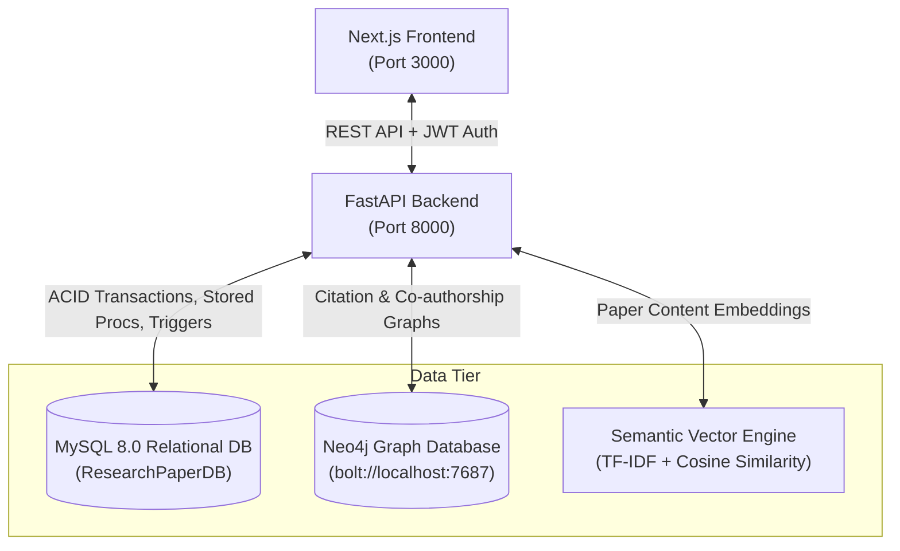

# ResearchHub - Research Paper Collaboration and Recommendation System

An academic collaboration, discovery, and citation exploration platform engineered for the **DBMS Level 3 Mini-Project** (PES University).

ResearchHub combines a **relational database (MySQL 8.0)**, a **graph knowledge base (Neo4j)**, and a **vector semantic recommendation engine** wrapped in a **FastAPI backend** and a modern **Next.js frontend**.

---

##  System Architecture



### Why Multi-Model Databases?
1. **MySQL 8.0 (Relational)**: Manages structured entities with strict ACID integrity: users, paper metadata, author orders, topic classifications, audit timestamps, and automated citation triggers.
2. **Neo4j (Graph Database)**: Models multi-hop academic networks: `(:Paper)-[:CITES]->(:Paper)` and `(:Researcher)-[:AUTHORED]->(:Paper)`. Enables deep graph traversals, co-authorship discovery, and network centrality queries.
3. **Vector Recommendation Engine**: Overcomes exact keyword matching limitations by calculating semantic vector similarities on paper titles and abstracts.

---

##  DBMS Level 3 Academic Requirements Checklist

| Requirement | Implementation in ResearchHub | Verification / Location |
| :--- | :--- | :--- |
| **Beyond CRUD** | Multi-hop citation networks, semantic recommendation engine, role-based workflows | Live across UI & API |
| **Relational Schema** | 8 tables: `Researchers`, `Papers`, `Topics`, `Paper_Authors`, `Paper_Topics`, `Citations`, `ResearchGroups`, `GroupMembers` | `researchhub_database.sql` |
| **Integrity Constraints** | Primary Keys, Foreign Keys (CASCADE/SET NULL), `UNIQUE` (Email, DOI, TopicName), `CHECK` (CitationCount >= 0, AuthorOrder > 0, no self-citations) | `researchhub_database.sql` |
| **SQL Views** | `PaperOverview` (aggregates authors and topics per paper)<br>`ResearcherPaperStats` (calculates papers and total citations per researcher) | Run in MySQL / Workbench |
| **Triggers** | `trg_citations_before_insert` (blocks self-citations)<br>`trg_citations_after_insert` (increments `CitationCount`)<br>`trg_citations_after_delete` (decrements `CitationCount`) | Tested on `/citations` |
| **Stored Procedures & Transactions** | `sp_SearchPapers` (Full-text natural language search)<br>`sp_GetResearcherPapers` (Author publication history)<br>`sp_AddPaperWithAuthor` (Atomic ACID transaction) | MySQL Stored Procedures |
| **Indexing** | Composite indexes on foreign keys, publication year, citations, and Full-Text Search index `ft_papers_title_abstract` | MySQL `SHOW INDEX FROM Papers;` |
| **Graph DB (NoSQL)** | **Neo4j** Cypher integration for citation networks and co-authorship graphs | `researchhub_neo4j.cypher` & `backend/graph_db.py` |
| **Role-Based Auth** | JWT Authentication with roles: `Student`, `Researcher`, and `Admin` | `POST /auth/login`, `POST /auth/register` |

---

## Demo Accounts

The database comes pre-seeded with accounts ready for evaluation and testing:

| Role | Email | Password | Details |
| :--- | :--- | :--- | :--- |
| **Admin** | `admin@researchhub.test` | `admin123` | Full access to `/admin` management dashboard |
| **Researcher** | `aarav.demo@researchhub.test` | `password123` | Machine Learning researcher at PES University |
| **Researcher** | `kabir.demo@researchhub.test` | `password123` | NLP researcher at IISc Bengaluru |
| **Student** | `diya.demo@researchhub.test` | `password123` | Data Science student researcher at PES University |

*Note: You can also register a new account on the `/register` page at any time.*


## 🕸️ Neo4j Graph Database Integration

A standalone Cypher script is provided in `researchhub_neo4j.cypher`.

### To visualize in Neo4j Browser:
1. Open Neo4j Desktop and start your database on port `7687`.
2. Open Neo4j Browser at `http://localhost:7474`.
3. Paste and run the queries from `researchhub_neo4j.cypher`:
   ```cypher
   // Visualize all nodes and relationships
   MATCH (n)-[r]->(m) RETURN n, r, m LIMIT 100;

   // Multi-hop citation discovery
   MATCH path = (p:Paper)-[:CITES*1..2]->(cited:Paper) RETURN path;

   // Co-authorship collaboration graph
   MATCH (r1:Researcher)-[:AUTHORED]->(p:Paper)<-[:AUTHORED]-(r2:Researcher)
   WHERE id(r1) < id(r2)
   RETURN r1.name AS Researcher1, r2.name AS Researcher2, p.title AS SharedPaper;
   ```
4. In the application: The backend features an automated sync endpoint at `POST /admin/sync-neo4j` and `POST /graph/sync` that populates Neo4j directly from MySQL records!

---

##  Running Automated Tests

To verify that all 14 API contracts and database triggers are operational:
```cmd
python backend/test_api.py
```

---

## 📂 Project Directory Structure

```text
mini_project/
├── backend/                        # FastAPI Backend Service
│   ├── main.py                     # App entry point, CORS, and Lifespan
│   ├── config.py                   # Environment variables & DB settings
│   ├── database.py                 # PyMySQL pool & query execution
│   ├── graph_db.py                 # Neo4j Driver & Cypher queries
│   ├── recommender.py              # TF-IDF Vector Similarity Recommender
│   ├── auth.py                     # JWT token & bcrypt password hashing
│   ├── models.py                   # Pydantic schemas (matching frontend)
│   ├── helpers.py                  # Relational object mappers
│   ├── test_api.py                 # End-to-end API test suite
│   └── routers/                    # Endpoint controllers
│       ├── auth_routes.py          # /auth/login, /auth/register
│       ├── users_routes.py         # /users/me, /users/me/papers
│       ├── papers_routes.py        # /papers CRUD
│       ├── researchers_routes.py   # /researchers, /researchers/{id}
│       ├── topics_routes.py        # /topics
│       ├── citations_routes.py     # /citations/network
│       ├── recommendations_routes.py # /recommendations
│       ├── dashboard_routes.py     # /dashboard/stats
│       ├── admin_routes.py         # /admin/overview, users, papers
│       └── graph_routes.py         # /graph/stats, /graph/coauthors
├── frontend/                       # Next.js 16 Application
│   ├── src/app/                    # App Router pages
│   ├── src/components/             # UI Components (AppLayout, Header, Sidebar)
│   ├── src/context/                # AuthContext
│   ├── src/lib/api.ts              # API client (configured for :8000)
│   └── .env.local                  # NEXT_PUBLIC_API_URL=http://localhost:8000
├── researchhub_database.sql        # MySQL 8.0 Complete DDL, Triggers, Views & Data
├── researchhub_neo4j.cypher        # Neo4j Cypher Schema & Graph Analytics Queries
├── start_all.bat                   # 1-Click launcher for both services
├── run_backend.bat                 # Launches FastAPI
├── run_frontend.bat                # Launches Next.js
└── init_database.bat               # Initializes MySQL Database
```
